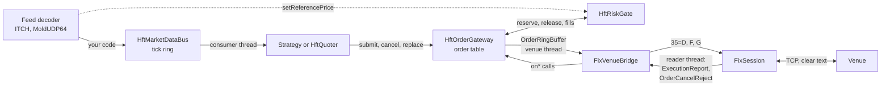

# Architecture

How the library is laid out and how the live order path behaves. Each
statement was checked against the code at the commit this file ships in;
paths are under `src/quantfinlib/` unless they say otherwise. For a
walk through the packages with runnable code, see [LEARN.md](LEARN.md).
For regulatory mapping, see [CONTROLS.md](CONTROLS.md).

This is a research and engineering reference. It is not a production
trading system: see [What this is not](#what-this-is-not).

## Packages and dependency direction

One static library, `quantfinlib`, C++26, standard library only (plus
`ws2_32` on Windows). Dependencies below come from the `#include` lines.

| Layer | Packages | Depends on |
|---|---|---|
| Foundations | `util`, `persist`, `orderbook`, `commodities`, `markets` | nothing in the library |
| Data | `marketdata`, `data`, `sbe`, `indicators` | `util`, `orderbook`; `data` uses `marketdata`; `indicators` uses `data` |
| Models | `volatility`, `pricing`, `rates`, `credit`, `fx`, `risk`, `crb` | lower models, `data`, `util` |
| Research | `microstructure`, `backtest`, `execution`, `alpha` | models, `data`, `orderbook`, `persist` |
| Connectivity | `fix` | `orderbook` (for `Side`), `persist` |
| Live lane | `trading` | `orderbook`, `marketdata`, `fix`, `execution`, `microstructure` |

`trading` sits on top, and nothing below includes it. Two edges are
weaker than this table suggests:

- `backtest` and `execution` include each other. `backtest` uses
  `execution/queue_fill_simulator.hpp` and `iceberg_order.hpp`; `execution`
  uses `backtest/validation/splittable_random.hpp`. The headers do not form
  a cycle, the packages do.
- `pricing` and `volatility` go one way only, `pricing` to `volatility`,
  but `volatility` reaches up to `data`.

Inside `trading`, only `hft_quoter.hpp` needs `microstructure`, and only
`paper_trading_gateway.hpp` needs `execution`. The gate and gateway need
just `orderbook/side.hpp`.

## The live order path

In order:

1. **Market data.** `HftMarketDataBus::publish` puts a tick on a
   preallocated ring. A symbol id out of range returns false and is
   counted. No class in `src` joins the ITCH codec or MoldUDP64 receiver to
   the bus: the application does that.
2. **Reference price.** The collar needs one. `ShardedTradingEngine::publish`
   refreshes the gate on every tick, and `PaperTradingGateway::onQuote`
   does it from the mid. A standalone gate gets nothing unless your feed
   code calls `setReferencePrice`; it then rejects every order, which is
   the intended failure.
3. **Strategy.** A `TickListener` runs on the bus consumer thread.
   `HftQuoter` is the shipped example: one working order per side, amended
   with `replace`.
4. **Gate and gateway.** `submit` runs `reserve`, the self-trade check and
   the ring publish as one step under a spinlock. It returns a positive id,
   a negative reason, or 0 for a full ring.
5. **Venue thread.** `pollOnce` sweeps on a new kill, checks the dead man,
   and drains the ring. Each message is re-checked against the kill under
   the lock before delivery.
6. **Bridge.** `FixVenueBridge` turns a `VenueMessage` into NewOrderSingle,
   OrderCancelRequest or OrderCancelReplaceRequest. A ClOrdID is
   `orderId | version << 40`.
7. **Fills back.** `FixSession`'s reader thread calls the bridge, which
   deduplicates fills on ExecID over a bounded window, books them through
   `HftOrderGateway::onFill`, and compares CumQty with its own count.

`OrderThrottle` exists, but the gateway does not call it. Message-rate
limiting is the caller's job.

The state of one order, with reservation rules, is in the comment at the
top of `trading/hft_order_gateway.hpp`. Experiment (f) in LEARN.md runs it.

## Threading and ownership

| Thread | Started by | Runs | Owns |
|---|---|---|---|
| Bus consumer | `HftMarketDataBus` | Tick listeners, so the strategy | Strategy and quoter state |
| Venue | `HftOrderGateway::start` | `pollOnce`: sweep, dead man, drain, listeners | `sweptEpoch_` |
| FIX reader | `FixSession` | Decode, session rules, bridge callbacks | ExecID window in the bridge |
| FIX heartbeat | `FixSession` | Heartbeats, TestRequest, staleness disconnect | Never waits for the write lock |
| Aggregator monitor | `GlobalRiskAggregator` | Polls gross notional, 1 ms in the example | Trip state |
| Application | You | Setup, `kill`, `halt`, `heartbeat` | Limits, set before trading |

Shared state and what protects it:

- **Gate.** Per-symbol atomics, with the order-flow fields and the
  market-data fields on separate cache lines. `reserve` adds to open first
  and validates after, so concurrent reservers see each other and the worst
  case is a spurious reject. A fill moves position, then releases open, and
  readers load open first: a reader can overstate exposure briefly, never
  understate it. Limits are setup-time and not synchronised.
- **Gateway table.** One spinlock, held across the reservation, the
  self-trade check and the ring publish, and never across a listener. It
  also serialises ring producers, so any thread may submit even though the
  ring itself is single-producer.
- **Rings.** Tick and order rings are single-producer, single-consumer,
  with acquire/release sequences.
- **Bus and gateway listeners.** An atomic pointer to an immutable list.
  Adding is a setup action. Old lists are retained until shutdown, since a
  drain may be walking one.
- **FIX session.** A recursive write mutex covers sequence allocation,
  store write and socket write. The venue thread takes it to send, so it
  can block for up to `Config::sendTimeoutMillis` (default 5000) on a
  stalled peer, after which the session disconnects.
- **Bridge.** A recursive mutex over the session pointer and unsent
  cancels, recursive because a failed send arrives back in `onDisconnect`
  on the same thread.
- **Book.** `HftOrderBook` is single-threaded by design: one thread owns
  it.

Lifetimes: the gateway outlives the bridge, and the bridge outlives every
session using it. `ShardedTradingEngine` gives each shard its own bus,
gate and gateway, sharing nothing; `GlobalRiskAggregator` is what looks
across them.

## Failure behaviour

The rule is to fail closed: refuse when safety cannot be shown.

**Before an order leaves.** A fresh gate has zero limits and rejects. Bad
symbol ids and NaN, infinite, zero or negative prices are rejected before
any limit. A missing reference rejects unless `disableReferenceCheck()`
was called. A bad tick leaves the last good reference in force.
`clearReferencePrice` makes a stale symbol reject.

**Kill sources.** Each is one latched bit in the gate:

| Bit | Tripped by | Cleared by |
|---|---|---|
| `KILL_OPERATOR` | `gate.kill(true)` | `gate.kill(false)` |
| `KILL_AGGREGATOR` | Gross over the cap, or a non-zero position with no price, on every gate | `manualReset()`, refused until gross is below `cap x resumeFraction` and all positions are priced |
| `KILL_DEAD_MAN` | `heartbeat()` quiet past the timeout, if armed | `gate.reset(...)` |
| `KILL_GATEWAY` | Overfill, unknown or mismatched fill, CumQty gap, bust or correction, unknown ExecType, unknown ClOrdID, session Reject or BusinessMessageReject, a listener that throws | `gate.reset(...)` |
| `KILL_VENUE_LINK` | Disconnect or logout | `gate.reset(...)`, not the reconnect |

While any bit is set, only an order that strictly reduces the position
passes. On a new trip the venue thread sweeps the table: queued orders end
there and working orders get cancels. Reduce-only orders accepted during
the kill are exempt from that sweep.

**Fills are facts.** A fill reaches the position even when it should not
exist, and the fault latches a kill for a person to look at.

**Losing the link.** Reservations stay, because the venue may still hold
the orders. Cancels that could not go out wait for the next Logon. A new
order with no session is refused back to the gateway. One whose send was
cut off stays reserved and is counted in `inDoubtCount()`, because the
store can replay it.

**Hostile input.** The first message must be a Logon, and CompIDs are
checked on every message. A garbled frame is ignored up to a small
consecutive limit. A GapFill obeys MsgSeqNum and is honoured only inside a
resend. On a ResendRequest, order messages older than
`maxOrderReplayAgeSeconds` are gap-filled, never replayed. Decoders are
fuzzed (`fuzz/`).

**Exceptions.** A bus listener that throws is counted and skipped for that
tick. A gateway listener that throws trips `KILL_GATEWAY`.

## Persistence and recovery

| What | Where | Survives restart |
|---|---|---|
| FIX sequence numbers | `FileSessionStore`, `seqnums.dat`: two CRC slots written alternately | Yes |
| Outbound application messages | `messages.dat`: length and CRC records, fsync per write | Yes, for resend |
| Learned model state | `Checkpoint`: temp file, then rename | Yes, restored at session start |
| Order table, reservations, positions | Memory | **No** |
| ExecID window | Memory | **No** |

Ordering matters at two points. Outbound, the message and the sequence
number are stored before the socket write (`FixSession::sendLocked`), so a
resend can always find it. Inbound, a message is dispatched before its
sequence number is saved, so a crash re-requests it: delivery is at least
once, and the ExecID window turns that into once within one process.

On open, a torn tail in `messages.dat` is truncated. A bad record with good
data after it is corruption and fails the open. `FileSessionStore` defaults
to `syncEveryWrite = true`. The default store in `FixSession` is in-memory,
so durability needs one passed to `initiate` or `accept`.

What a restart does not do: rebuild orders or positions, or query the venue.
There is no OrderStatusRequest or mass status. `nextId_` starts again at 1,
so ClOrdIDs repeat across a restart, and
replayed fills are not recognised. An old ClOrdID the table does not know
latches `KILL_GATEWAY`, which fails closed but leaves an operator to
reconcile by hand.

## What this is not

- **Not production.** This repository holds no record of it running against
  a real venue; it has been exercised by tests, loopback and simulation.
- **Not certified.** No venue has certified it and no conformance test has
  been run. [CONTROLS.md](CONTROLS.md) is an engineering map, not a
  compliance statement.
- **No TLS.** FIX runs in clear text, including Username(553) and
  Password(554). A deployment needs a private line or a terminator in front.
- **No order audit log or reconciliation.** The FIX store exists for resend.
  There is no drop copy.
- **No trader, desk or client on an order.** Kills and limits apply per gate.
- **Firm cap is not pre-trade.** `GlobalRiskAggregator` polls, so it trips
  after a breach.
- **No claim of edge or of latency on real networks.** Benchmarks measure
  code paths on the host they ran on. See experiment (e) in LEARN.md.
